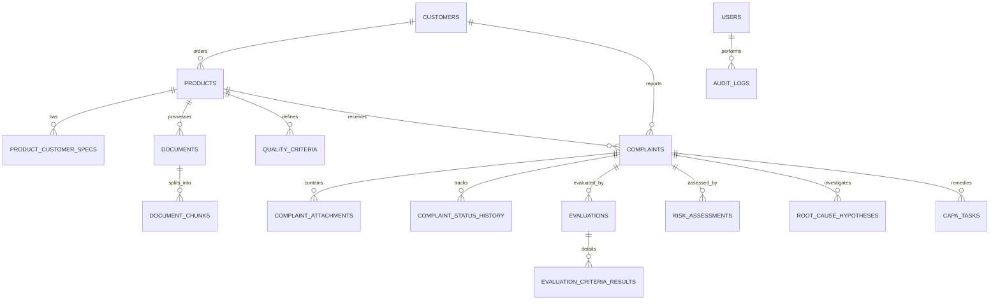

# NEXUS: Code Space Techlab AI Quality Control & Complaint Management System
> **Machine-Readable Architectural & Domain Specification for AI Coding Agents**  
> *Purpose: Provide maximum information density on system design, data schemas, business rules, and developer conventions to prevent hallucination and eliminate token waste.*

---

## 1. Domain & Business Context
- **Organization:** Code Space Techlab (Precision OEM/ODM Manufacturer).
- **Client Base:** Supplies contract furniture, ergonomic seating, and engineered goods to **IKEA** (primary partner), commercial retailers (e.g., Target), and direct enterprise clients.
- **Core Problem Space:**
  - High volume of customer and factory quality complaints across dimensional defects, chemical/safety compliance, transit packaging damage, and mechanical durability.
  - Stringent customer-specific standards: IKEA packaging standards, REACH SVHC chemical regulations, EN 717-1 formaldehyde emission limits, ANSI/BIFMA X5.1 task chair durability standards.
  - Need for automated, evidence-backed quality evaluation with grounded source citations (document ID, revision, page, section), deterministic scoring, 4-tier risk matrix, 8D CAPA tracking, and RBAC governance.

---

## 2. Technology Stack & Runtime Configuration

| Component | Technology | Rationale / Configuration |
| :--- | :--- | :--- |
| **UI Framework** | Streamlit (Python 3.11+) | Multi-page layout (`app.py` entrypoint + 8 pages in `pages/`) |
| **Relational DB** | SQLite 3 (WAL Mode) | `data/quality_ai.db`, connection pool via `get_db()` context manager, FTS5 full-text search |
| **Vector DB** | ChromaDB Persistent Client | `data/vector_store/`, sentence-transformers `all-MiniLM-L6-v2` |
| **Hybrid Retrieval** | Dense Semantic + FTS5 BM25 | Reciprocal Rank Fusion (RRF), $\alpha = 0.6$ semantic, $0.4$ keyword |
| **Headless API** | FastAPI + Pydantic v2 | `src/api/router.py`, fully decoupled headless REST endpoints |
| **PDF Reporting** | ReportLab | Formatted multi-page executive investigation dossiers with tables & badges |
| **Excel Reporting**| openpyxl | Multi-tab executive analytics spreadsheets (KPIs, Complaints, CAPA) |
| **Auth & Security**| PBKDF2-SHA256 + Salt | Stored in SQLite `users`, RBAC permission matrix in `src/auth/` |
| **Containerization**| Docker / Streamlit Cloud | Multi-stage Dockerfile, auto-seeding on fresh ephemeral cloud boot |

---

## 3. System Architecture & Directory Map

```
Quality_check_RAG/
├── NEXUS.md                       # Master AI context specification (This file)
├── README.md                      # Human-facing project overview & quickstart
├── app.py                         # Streamlit entrypoint, auth portal & module router
├── requirements.txt               # Pinned dependencies (streamlit, chromadb, fastapi, etc.)
├── pytest.ini                     # Pytest root configuration
├── Dockerfile                     # Production container deployment
├── data/                          # Runtime persistent storage (gitignored *.db, *.parquet)
│   ├── quality_ai.db              # SQLite relational & FTS5 database
│   ├── uploads/                   # Raw customer & document uploads
│   ├── processed/                 # Extracted text & chunk caches
│   └── vector_store/              # ChromaDB vector index collections
├── pages/                         # Streamlit Multi-Page UI Views
│   ├── 01_Dashboard.py            # Operations KPIs, Plotly trends, risk funnels, Pareto charts
│   ├── 02_Products.py             # Product registry, BOM specs, IKEA customer standards
│   ├── 03_Documents.py            # Knowledge base ingestion, chunk inspector, RAG assistant
│   ├── 04_Complaints.py           # Intake form, bulk CSV import, lifecycle timeline
│   ├── 05_Quality_Evaluation.py   # Deterministic rules engine, explainable scoring, manager sign-off
│   ├── 06_Compliance.py           # Document gap auditor, 4-tier risk matrix, 8D CAPA manager
│   ├── 07_Reports.py              # Export hub (PDF dossiers, multi-tab Excel, CSV dumps)
│   └── 08_Admin_Settings.py       # RBAC user management, criteria builder, audit logs, DB reset
├── src/                           # Pure Python Core Domain Services
│   ├── config.py                  # Pydantic Settings (paths, models, hyperparameters)
│   ├── ui_components.py           # Reusable Streamlit CSS styling, badges, headers, KPI cards
│   ├── database/
│   │   ├── connection.py          # SQLite WAL connection manager with row factory
│   │   ├── schema.py              # DDL schema (16 tables + FTS5 + triggers) & user bootstrap
│   │   └── models.py              # Data model dataclasses and type definitions
│   ├── auth/
│   │   ├── service.py             # PBKDF2 hashing, user CRUD (idempotent), login verification
│   │   └── permissions.py         # 5-Tier RBAC permission matrix & route guards
│   ├── products/
│   │   └── service.py             # Products, customer specs, and catalog service (idempotent)
│   ├── document_processing/
│   │   ├── parsers.py             # PDF (PyMuPDF), DOCX (python-docx), XLSX (openpyxl), CSV, TXT
│   │   ├── chunker.py             # Structure-aware chunking (500 tokens max, 100 overlap)
│   │   └── service.py             # Multi-stage document ingestion pipeline
│   ├── retrieval/
│   │   ├── vector_store.py        # ChromaDB persistent collection interface
│   │   ├── keyword_search.py      # SQLite FTS5 BM25 keyword matching engine
│   │   └── hybrid_retriever.py    # Reciprocal Rank Fusion (RRF) hybrid search
│   ├── rag/
│   │   ├── prompt_builder.py      # Injection-hardened prompt templates with strict citation rules
│   │   ├── llm_adapter.py         # Ollama/OpenAI client with deterministic mock fallback
│   │   └── service.py             # Quality RAG Q&A service returning grounded answers + citations
│   ├── quality_engine/
│   │   ├── criteria_manager.py    # Quality criteria definitions & customer inheritance
│   │   ├── rule_evaluator.py      # Deterministic evaluation against RAG evidence & specs
│   │   ├── scorer.py              # Weighted scoring + mandatory failure override logic
│   │   └── approval.py            # Quality Manager sign-off workflow (Approve/Reject/Escalate)
│   ├── complaint_management/
│   │   ├── service.py             # Complaint lifecycle CRUD, transitions, batch imports
│   │   └── capa.py                # 8D CAPA tracking, task assignments, effectiveness verification
│   ├── compliance/
│   │   ├── gap_analyzer.py        # Missing document & expired specification detector
│   │   └── risk_matrix.py         # 4-Tier risk matrix (Severity × Likelihood + Safety flags)
│   ├── reporting/
│   │   ├── pdf_generator.py       # ReportLab PDF investigation report compiler
│   │   └── excel_generator.py     # openpyxl multi-tab executive workbook generator
│   ├── audit/
│   │   └── logger.py              # Append-only immutable audit trail logger
│   └── api/
│       ├── router.py              # Headless FastAPI endpoints for headless integration
│       └── schemas.py             # Pydantic v2 request/response schemas
├── scripts/
│   └── seed_demo_data.py          # Synthetic dataset seeder (products, docs, criteria, complaints)
└── tests/                         # Pytest test suite (18 automated integration tests)
    ├── test_auth.py
    ├── test_complaints_lifecycle.py
    ├── test_quality_engine.py
    ├── test_reporting_api.py
    └── test_retrieval_rag.py
```

---

## 4. Relational Database Schema & Data Dictionary

Database engine: **SQLite 3** (`PRAGMA journal_mode=WAL; PRAGMA foreign_keys=ON;`).



### Table Definitions & Key Constraints
1. **`customers`**: `id`, `code` (UNIQUE, e.g. `CUST-IKEA`), `name`, `customer_type` (`IKEA`, `Retailer`, `Direct Customer`), `contact_name`, `contact_email`, `notes`.
2. **`products`**: `id`, `sku` (UNIQUE, e.g. `NDT-800`, `ETC-450`, `WCC-300`), `name`, `category`, `description`, `materials_summary`, `batch_prefix`, `target_market`, `revision`, `status` (`Active`, `Archived`).
3. **`product_customer_specs`**: `id`, `product_id` (FK), `customer_id` (FK), `spec_title`, `spec_content`, `revision`, `effective_date`.
4. **`documents`**: `id`, `document_id` (UNIQUE, e.g. `DOC-2026-0001`), `product_id` (FK), `customer_id` (FK, nullable), `category` (`Product Specification`, `Chemical Safety & REACH`, `Customer-Specific Requirement`, `Packaging & Labeling`, `Test Report`), `title`, `file_name`, `file_path`, `file_type`, `file_size_bytes`, `revision`, `effective_date`, `expiry_date`, `approval_status` (`Approved`, `Draft`, `Expired`, `Rejected`).
5. **`document_chunks`**: `id`, `document_id` (FK), `chunk_index`, `content`, `section_title`, `page_number`, `token_count`, `vector_id` (UUID matching ChromaDB).
6. **`document_fts`**: FTS5 virtual table for BM25 keyword retrieval indexing `(content, section_title, document_title, document_category)`.
7. **`quality_criteria`**: `id`, `product_id` (FK), `customer_id` (FK, nullable), `criterion_code` (UNIQUE, e.g. `CRIT-DIM-01`), `name`, `category`, `criterion_type` (`Numeric Range`, `Required Document`, `Tolerance Check`, `Boolean Check`), `expected_value`, `min_allowed`, `max_allowed`, `measurement_unit`, `is_mandatory` (0 or 1), `weight` (Float, e.g. 1.0 to 3.0), `status` (`Active`, `Deprecated`).
8. **`complaints`**: `id`, `complaint_number` (UNIQUE, e.g. `CMP-2026-0001`), `reporter_type` (`IKEA`, `Retailer`, `Direct Customer`, `Internal QC`), `customer_id` (FK, nullable), `product_id` (FK), `sku`, `order_batch_number`, `category` (`Dimensional defects`, `Chemical or material concerns`, `Packaging & transit damage`, `Durability & fatigue failure`, `Cosmetic finish`, `Assembly / hardware missing`), `severity` (`Low`, `Medium`, `High`, `Critical`), `urgency` (`Low`, `Medium`, `High`), `status` (`Submitted`, `Triaged`, `Under Investigation`, `Awaiting Evidence/Testing`, `Manager Review`, `Approved`, `Rejected`, `Escalated`, `Closed`), `quantity_affected`, `description`, `reported_date`.
9. **`complaint_status_history`**: `id`, `complaint_id` (FK), `old_status`, `new_status`, `changed_by_user_id` (FK), `change_notes`, `created_at`.
10. **`complaint_attachments`**: `id`, `complaint_id` (FK), `file_name`, `file_path`, `file_type`, `file_size_bytes`, `uploaded_by_user_id` (FK).
11. **`evaluations`**: `id`, `complaint_id` (FK, UNIQUE), `evaluated_by_user_id` (FK), `overall_score` (Float 0-100), `overall_outcome` (`Pass`, `Warning`, `Fail`, `Inconclusive`), `evidence_completeness_pct`, `summary_explanation`, `mandatory_failures_count`, `approval_status` (`Pending Review`, `Approved`, `Rejected`, `Escalated`), `reviewed_by_user_id` (FK), `review_notes`, `reviewed_at`.
12. **`evaluation_criteria_results`**: `id`, `evaluation_id` (FK), `criterion_id` (FK), `criterion_code`, `criterion_name`, `criterion_type`, `is_mandatory`, `weight`, `observed_value`, `expected_value`, `outcome` (`Pass`, `Warning`, `Fail`, `Insufficient Evidence`), `score_awarded`, `max_score`, `finding_notes`, `citations_json` (serialized JSON array of citation objects).
13. **`risk_assessments`**: `id`, `complaint_id` (FK), `evaluation_id` (FK), `severity_level` (`Low`, `Medium`, `High`, `Critical`), `likelihood_level`, `affected_units_level`, `repeat_defect_count`, `safety_hazard_flag` (0 or 1), `overall_risk_level` (`Low`, `Medium`, `High`, `Critical`), `calculated_risk_score`, `escalation_required` (0 or 1), `mitigation_summary`.
14. **`root_cause_hypotheses`**: `id`, `complaint_id` (FK), `discipline` (8 Disciplines), `hypothesis_statement`, `five_whys_trail`, `confidence_level` (`Low`, `Medium`, `High`), `verification_status` (`Unverified`, `Confirmed Root Cause`, `Ruled Out`), `verified_by_user_id` (FK).
15. **`capa_tasks`**: `id`, `complaint_id` (FK), `evaluation_id` (FK), `capa_type` (`Immediate Containment`, `Corrective Action`, `Preventive Action`), `title`, `description`, `assigned_to_user_id` (FK), `department`, `priority` (`Low`, `Medium`, `High`, `Urgent`), `due_date`, `status` (`Open`, `In Progress`, `Pending Verification`, `Verified Effective`, `Closed`), `outcome_notes`, `effectiveness_verification`, `verified_by_user_id` (FK), `verified_at`.
16. **`users`**: `id`, `username` (UNIQUE), `password_hash`, `salt`, `full_name`, `email` (UNIQUE), `role` (`Admin`, `Quality Manager`, `Quality Engineer`, `Customer`, `Management Viewer`), `customer_id` (FK, nullable), `is_active` (0 or 1).
17. **`audit_logs`**: `id`, `action`, `entity_type`, `entity_id`, `user_id` (FK, nullable), `details_json`, `ip_address`, `timestamp`.

---

## 5. Core Engines & Algorithmic Specifications

### 5.1 Hybrid RAG & Reciprocal Rank Fusion (RRF)
- **Vector Retrieval:** Queries ChromaDB collection using cosine similarity of query text against chunk text embeddings (`all-MiniLM-L6-v2`).
- **Keyword Retrieval:** Queries SQLite FTS5 using BM25 ranking (`MATCH ? ORDER BY rank`).
- **Fusion Formula (RRF):**
  $$RRF\_Score(d) = \alpha \cdot \frac{1}{60 + rank_{dense}(d)} + (1 - \alpha) \cdot \frac{1}{60 + rank_{keyword}(d)}$$
  *(Default: $\alpha = 0.6$, candidate pool = 20, returned top $k = 5$ or $6$).*
- **Source Citation Contract:** Every returned chunk must preserve and propagate:
  ```json
  {
    "document_id": "DOC-2026-0001",
    "title": "NDT-800 Approved Specification Rev 1.2",
    "revision": "1.2",
    "page": 2,
    "section": "Dimensional Tolerances"
  }
  ```

### 5.2 Deterministic Quality Evaluation Engine
- **No LLM Hallucinations on Numeric Limits:** Quality evaluation rules are evaluated through deterministic Python routines, not by prompting an LLM to guess pass/fail.
- **Rule Types Evaluated:**
  1. `Numeric Range`: Extracts numbers from complaint descriptions using regex `\b\d+(?:\.\d+)?\b`. Compares against `[min_allowed, max_allowed]`.
     - Inside range $\implies$ `Pass` (100.0).
     - Outside range $\implies$ `Fail` (0.0). Calculates deviation metric.
  2. `Required Document`: Queries SQLite for an active, approved document in the specified category (e.g., REACH Chemical Declaration).
     - Document found & approved $\implies$ `Pass` (100.0).
     - Document missing or expired $\implies$ `Fail` (0.0).
  3. `Tolerance Check` / `Text Contains`: Matches keywords or tolerance patterns.
  4. `Boolean Check`: Validates presence of mandatory hardware/items.

### 5.3 Explainable Weighted Scoring & Mandatory Override
- **Weighted Average Formula:**
  $$\text{Raw Score} = \frac{\sum (w_i \cdot s_i)}{\sum w_i} \times 100$$
  where $w_i$ is criterion weight, $s_i \in \{1.0 \text{ (Pass)}, 0.5 \text{ (Warning)}, 0.0 \text{ (Fail/Missing)}\}$.
- **CRITICAL BUSINESS OVERRIDE:**
  $$\text{If } \text{mandatory\_failures\_count} > 0 \implies \mathbf{Overall\ Outcome = "Fail"}$$
  *Even if the numerical weighted score is 95%, a single mandatory violation (e.g., REACH SVHC toxic emissions or chair cylinder creep) strictly forces the verdict to `Fail`.*
- **Outcome Thresholds (when mandatory failures = 0):**
  - $\ge 85.0\%$ with 0 warnings $\implies$ `Pass`
  - $\ge 70.0\%$ $\implies$ `Warning`
  - $< 70.0\%$ $\implies$ `Fail`
  - $> 50\%$ criteria with insufficient evidence $\implies$ `Inconclusive`

### 5.4 4-Tier Risk Matrix & Safety Escalation
- **Calculation:**
  $$\text{Risk Score} = \text{Severity} \times \left( \frac{\text{Recurrence Frequency} + \text{Units Affected}}{2} \right)$$
  - Severity: Low (1), Medium (2), High (3), Critical (4).
  - Recurrence Frequency: 0 repeats (1), 1-2 repeats (2), 3-5 repeats (3), >5 repeats (4).
  - Units Affected: 1 unit (1), 2-10 units (2), 11-50 units (3), >50 units (4).
- **Safety Hazard Override:** If category is chemical, or narrative contains hazard keywords (`toxic`, `reach`, `fumes`, `lead`, `collapse`, `burn`, `injury`), score is set to $\ge 12.0$ and Level forced to `Critical`.
- **Escalation Trigger:** All `Critical` cases automatically set `escalation_required = 1` and trigger executive notification.

### 5.5 Root-Cause Analysis (8 Disciplines) & CAPA Lifecycle
- **8 Disciplines Evaluated:**
  1. Material defect (supplier raw material variation)
  2. Process parameter drift (machining, curing, finishing temps)
  3. Tooling wear (cutter dulling, die wear)
  4. Packaging deficiency (bursting strength, corner protection)
  5. Environmental fluctuation (transit humidity, storage temp)
  6. Operator SOP gap (assembly sequence error)
  7. Logistics impact (carrier drop damage, vibration)
  8. Specification ambiguity (tolerance conflict)
- **CAPA Progression:**
  `Open` ➔ `In Progress` ➔ `Pending Verification` ➔ `Verified Effective` ➔ `Closed`.

---

## 6. Role-Based Access Control (RBAC) Matrix

| Feature / Action | Admin | Quality Manager | Quality Engineer | Customer (IKEA) | Management Viewer |
| :--- | :---: | :---: | :---: | :---: | :---: |
| **View Dashboard & KPIs** | ✅ | ✅ | ✅ | ❌ | ✅ |
| **Browse Product Catalog** | ✅ | ✅ | ✅ | ✅ (Scoped) | ✅ |
| **Ingest / Approve Documents** | ✅ | ✅ | ❌ | ❌ | ❌ |
| **Submit New Complaint** | ✅ | ✅ | ✅ | ✅ (Own SKU) | ❌ |
| **Run Quality Evaluation** | ✅ | ✅ | ✅ | ❌ | ❌ |
| **Approve / Reject Evaluation**| ✅ | ✅ | ❌ | ❌ | ❌ |
| **Assign & Update CAPA** | ✅ | ✅ | ✅ | ❌ | ❌ |
| **Verify CAPA Effectiveness** | ✅ | ✅ | ❌ | ❌ | ❌ |
| **Download PDF / Excel Reports**| ✅ | ✅ | ✅ | ✅ (Scoped) | ✅ |
| **Manage Users & DB Reset** | ✅ | ❌ | ❌ | ❌ | ❌ |

---

## 7. Pre-Seeded Credentials (Password: `Quality2026!`)

| Username | Role | Full Name | Email | Customer Scope |
| :--- | :--- | :--- | :--- | :--- |
| **`admin`** | Admin | System Administrator | `admin@codespace-techlab.demo` | System Wide |
| **`manager1`** | Quality Manager | Sarah Jenkins | `sjenkins@codespace-techlab.demo` | Internal QA |
| **`engineer1`** | Quality Engineer | Marcus Chen | `mchen@codespace-techlab.demo` | Internal QA |
| **`viewer1`** | Management Viewer | David Rossi | `drossi@codespace-techlab.demo` | Operations |
| **`ikea_rep`** | Customer | Elin Bergstrom | `elin.b@ikea-supply.demo` | IKEA (`CUST-IKEA`) |

---

## 8. Critical Implementation Gotchas & Conventions

### ⚠️ Gotcha 1: Infinite Recursion on DB Initialization
- **Problem:** `seed_all_demo_data()` in `scripts/seed_demo_data.py` calls `init_db()`. If `init_db()` in `src/database/schema.py` calls `seed_all_demo_data()`, Python triggers `RecursionError: maximum recursion depth exceeded`.
- **Rule:** `init_db()` in `schema.py` MUST ONLY insert basic default customers and the 5 pre-seeded users directly using pure SQL (`INSERT OR IGNORE`). It must NEVER invoke `scripts.seed_demo_data`.

### ⚠️ Gotcha 2: Streamlit Cloud Ephemeral Database
- **Problem:** Streamlit Community Cloud clones from Git without `.db` files (due to `.gitignore`). On first boot, SQLite is initialized completely empty.
- **Rule:** `app.py` runs `init_db()` followed by a check: `if conn.execute("SELECT COUNT(*) FROM products").fetchone()[0] == 0: seed_all_demo_data(reset=False)`. This ensures cloud deployments auto-populate the catalog, documents, and complaints without manual CLI intervention.

### ⚠️ Gotcha 3: Idempotent Entity Creation
- **Rule:** All database helper functions (`create_user`, `create_customer`, `create_product`, `create_quality_criterion`) MUST be idempotent. If a record with the same unique key (`username`, `code`, `sku`, `criterion_code`) already exists, return the existing `id` or perform an update, never throw a raw SQLite `IntegrityError`.

### ⚠️ Gotcha 4: SQLite WAL Mode Concurrency
- **Rule:** Always acquire database connections via the `with get_db() as conn:` context manager from `src.database.connection`. Never open raw standalone connections that skip `PRAGMA journal_mode=WAL;` and `PRAGMA foreign_keys=ON;`.

### ⚠️ Gotcha 5: Streamlit Session State & Multi-Page Navigation
- **Rule:** Authenticated user profile is stored at `st.session_state["authenticated_user"]`. All sub-pages in `pages/` must call `render_sidebar_auth_status()` and check `require_role(...)` before rendering sensitive actions. Use `st.page_link` for intra-app navigation to preserve session state.

---

## 9. Headless REST API Endpoints (`src/api/router.py`)

| Method | Endpoint | Description | Auth / Scope |
| :--- | :--- | :--- | :--- |
| `GET` | `/api/v1/health` | Healthcheck and service version | Public |
| `GET` | `/api/v1/products` | Retrieve active product catalog | Authenticated |
| `GET` | `/api/v1/products/{id}` | Retrieve product details by ID | Authenticated |
| `POST` | `/api/v1/complaints` | Register a new complaint | Authenticated |
| `GET` | `/api/v1/complaints/{id}`| Fetch complaint details and timeline | Authenticated |
| `PATCH`| `/api/v1/complaints/{id}`| Update complaint lifecycle status | QA / Admin |
| `POST` | `/api/v1/evaluations/{id}`| Execute deterministic evaluation | QA / Admin |
| `POST` | `/api/v1/evaluations/{id}/approve` | Quality Manager sign-off | Manager / Admin |
| `POST` | `/api/v1/rag/query` | Grounded RAG search with citations | Authenticated |

---

## 10. Automated Testing & Verification
The test suite consists of 18 integration tests covering all critical workflows:
```bash
# Execute entire test suite
pytest -v

# Run specific functional domains
pytest tests/test_auth.py
pytest tests/test_complaints_lifecycle.py
pytest tests/test_quality_engine.py
pytest tests/test_retrieval_rag.py
pytest tests/test_reporting_api.py
```
*Current test pass rate: 18 / 18 passing (100%).*
